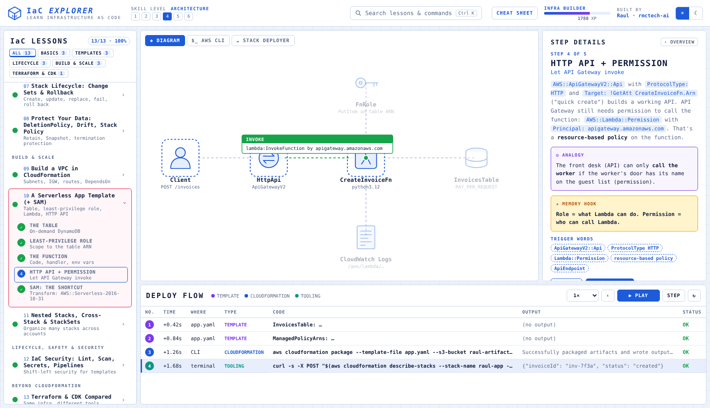

# 🏗️ IaC Explorer — Learn Infrastructure as Code with CloudFormation

An interactive, step-by-step course on **Infrastructure as Code** for Cloud Engineers: CloudFormation from your first template to multi-stack, multi-account deployments, SAM for serverless, IaC security scanning (cfn-lint, cfn-guard, Checkov, dynamic references) and a hands-on comparison with **Terraform** and **CDK**. Every lesson animates how a template becomes a stack, with analogies, memory hooks, trigger words, quizzes, and a **Stack Deployer lab** that validates and "deploys" your YAML like CloudFormation does.

> Created by **Raul** ([@rmctech-ai](https://github.com/rmctech-ai)) · Freelance AI Automation Specialist on the path to Cloud Security.
> Part of the Explorer series: [Linux Explorer](https://github.com/rmctech-ai/linux-explorer) · [Python Explorer](https://github.com/rmctech-ai/python-explorer) · [IAM Explorer](https://github.com/rmctech-ai/iam-explorer) · [VPC Explorer](https://github.com/rmctech-ai/vpc-explorer) · [Serverless Explorer](https://github.com/rmctech-ai/serverless-explorer) · [CI/CD Explorer](https://github.com/rmctech-ai/cicd-explorer) · [Cloud Security Explorer](https://github.com/rmctech-ai/cloudsecurity-explorer).
> 🏠 Part of **[Raul's Cloud Learning Hub](https://rmctech-ai.github.io/)** · Live course: https://rmctech-ai.github.io/iac-explorer/
> The Explorer course format is inspired by [Protocol Explorer](https://protocol-explorer-alpha.vercel.app/) by Dilum Sanjaya. All lessons, labs and study tools are my own work.



---

## ▶ Run it

No build step. Plain HTML/CSS/JS.

```bash
python3 -m http.server 8000     # then open http://localhost:8000
```

### Publish on GitHub Pages
```bash
git init && git add . && git commit -m "IaC Explorer"
git branch -M main
git remote add origin https://github.com/rmctech-ai/iac-explorer.git
git push -u origin main
```
GitHub → **Settings → Pages → Deploy from a branch → `main` / root → Save** → `https://rmctech-ai.github.io/iac-explorer/`

---

## 🧭 How to use it

| Area | What it does |
|---|---|
| **Lessons** (left) | 13 lessons grouped by track. Click to expand steps. Dots show progress. |
| **Diagram** tab | Animated scene for every step. |
| **$_ AWS CLI** tab | Types out real commands/code for the step with realistic output. |
| **☁ STACK DEPLOYER** tab | **Stack Deployer**: write CloudFormation YAML or JSON, set parameters and press DEPLOY. The simulator parses YAML (with `!Ref`, `!GetAtt`, `!Sub`, `!If`… short tags), validates like CloudFormation (unknown types, unresolved references, required properties, AllowedValues, circular dependencies), creates resources in dependency order, resolves intrinsic functions, shows stack events, rolls back on failure (respecting `DeletionPolicy: Retain`), and shows a change set with replacement warnings when you deploy twice. Each challenge checks the deployed result and tells you exactly what is still missing. |
| **Step Details** (right) | Explanation, **Analogy**, **Memory Hook**, **Trigger Words**, real-world notes, warnings. |
| **Deploy Flow** (bottom) | Log of every command so far with type, output and status. |
| **XP & levels** | Earn XP for steps, lessons, quizzes and challenges. Saved in your browser. |
| **Cheat Sheet** | Master hooks + key syntax for every lesson (also [`CHEATSHEET.md`](CHEATSHEET.md)). |

**Keyboard:** `→` / `←` steps · `Space` play · `Ctrl+K` search · `Esc` close.

---

## 📚 Curriculum (13 lessons · 65 steps · 52 quiz questions · 12 hands-on challenges)

| # | Lesson | Track | You'll learn |
|---|---|---|---|
| 01 | What is Infrastructure as Code? | BASICS | Describe infrastructure in files, not clicks |
| 02 | Your First Template ⚑ | BASICS | Resources, Type, Properties, deploy |
| 03 | YAML Survival Guide ⚑ | BASICS | Indentation, lists, maps, quotes, tags |
| 04 | Parameters & Outputs ⚑ | TEMPLATES | One template, many environments |
| 05 | Intrinsic Functions & Dependencies ⚑ | TEMPLATES | !Ref, !GetAtt, !Sub, !Join, !Select |
| 06 | Mappings & Conditions ⚑ | TEMPLATES | Lookup tables and environment logic |
| 07 | Stack Lifecycle: Change Sets & Rollback ⚑ | LIFECYCLE | Create, update, replace, fail, roll back |
| 08 | Protect Your Data: DeletionPolicy, Drift, Stack Policy ⚑ | LIFECYCLE | Retain, Snapshot, termination protection |
| 09 | Build a VPC in CloudFormation ⚑ | BUILD & SCALE | Subnets, IGW, routes, DependsOn |
| 10 | A Serverless App Template (+ SAM) ⚑ | BUILD & SCALE | Table, least-privilege role, Lambda, HTTP API |
| 11 | Nested Stacks, Cross-Stack & StackSets ⚑ | BUILD & SCALE | Organize many stacks across accounts |
| 12 | IaC Security: Lint, Scan, Secrets, Pipelines ⚑ | LIFECYCLE | Shift-left security for templates |
| 13 | Terraform & CDK Compared ⚑ | TERRAFORM & CDK | Same infra, different tools |

⚑ = has a hands-on challenge.

## 🎯 Study plan & capstone

- **Week 1:** Lessons 1–6 (IaC concepts, first template, YAML, parameters/outputs, intrinsic functions, mappings & conditions). Solve every deployer challenge.
- **Week 2:** Lessons 7–10 (lifecycle & rollback, protecting data, a VPC template, a serverless app + SAM).
- **Week 3:** Lessons 11–13 (multi-stack & StackSets, IaC security & pipelines, Terraform & CDK).

**Capstone:** In a free-tier AWS account, deploy the lesson 9 network stack and the lesson 10 serverless app with `aws cloudformation deploy`, add cfn-lint + Checkov to a GitHub Actions workflow, enable termination protection, run drift detection after a manual change, then rebuild the bucket from lesson 2 in Terraform. Document everything in a GitHub repo.

## License
MIT © 2026 Raul (rmctech-ai)
